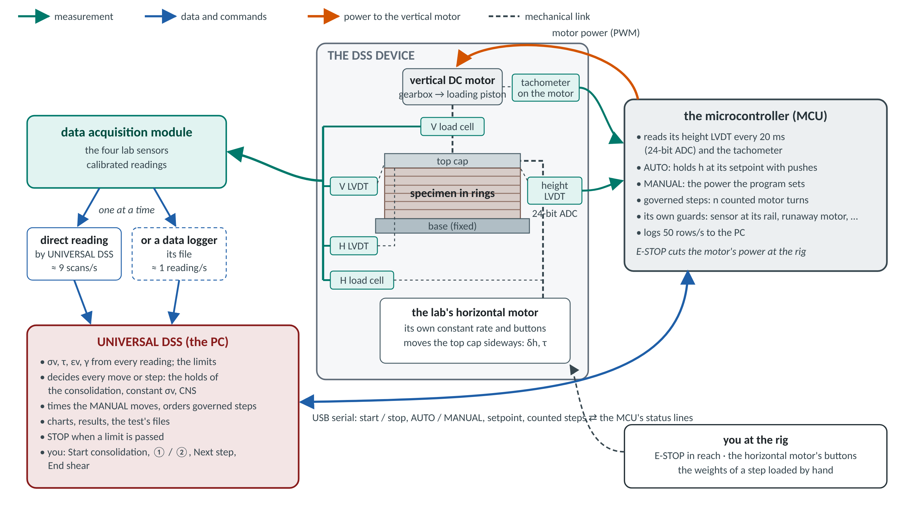
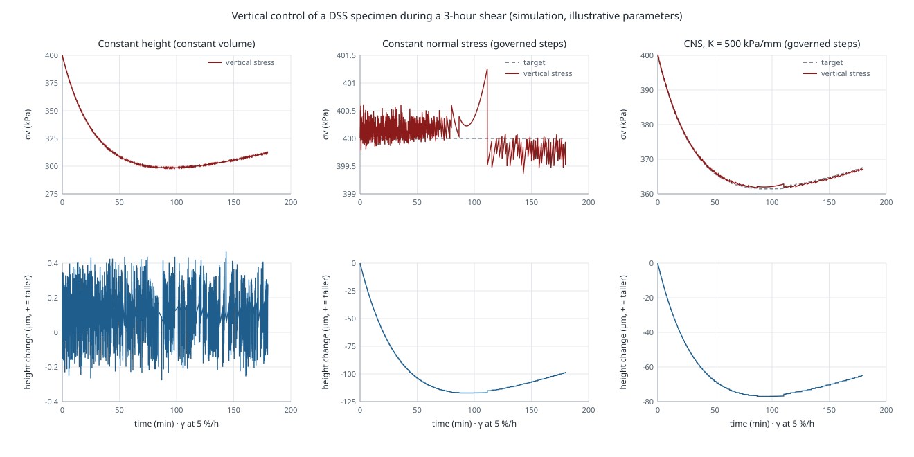

# DSS vertical control

**Automated vertical control of a direct simple shear (DSS) device: constant height, constant normal stress and constant normal stiffness, driven by a small microcontroller.**

I designed and built **UNIVERSAL DSS**, a control and data program that runs a complete DSS test on a laboratory device: step-loaded consolidation followed by monotonic or cyclic shear. A microcontroller board (MCU) with its own firmware drives the device's original DC gear motor, and a PC program decides every move from the sensor readings. This repository explains the control methods behind it, shows how they were calibrated and verified, and gives a runnable simulation so that others can apply the same ideas to their own equipment.

> The program's source code is not published here. The repository documents the methods, the design decisions and the verification.

## Highlights

- **Three vertical boundary conditions in the shear:** constant height (constant volume), constant normal stress, and constant normal stiffness (CNS).
- **Constant height on a 24-bit height reading:** a 0.3 mV dead band, with every motor push capped so that a single push changes the vertical load by less than about 1 kPa.
- **The vertical load held at its target within a ±1 kPa band** by counted motor steps, each sized from a load-per-turn value that the program learns during the test.
- **Step-loaded consolidation:** ramped loading, holding in both directions, and an automatic step end. Results per step: t50, t90, cv, mv, Cαε and σ′p.
- **Layered safety:** an emergency stop, sensor limits, a load guard and the MCU's own guards.

## Contents

- [The rig](#the-rig)
- [Controlling the vertical axis](#controlling-the-vertical-axis)
- [Lessons that made it work](#lessons-that-made-it-work)
- [Calibration and verification](#calibration-and-verification)
- [Try it: the simulation](#try-it-the-simulation)
- [Formulas used](#formulas-used)
- [References](#references)
- [How to cite](#how-to-cite)

## Repository structure

```
direct-simple-shear-vertical-control/
├── README.md                      this overview
├── docs/
│   ├── vertical-control-guide.md  step-by-step guide to controlling the vertical axis
│   └── figures/                   the rig and the simulation results
├── examples/
│   └── vertical_control_sim.py    simulation of the three shear boundary conditions (no packages needed)
├── CITATION.cff                   citation information
└── LICENSE                        MIT
```

## Quick start

```bash
git clone https://github.com/mortezashafiei/direct-simple-shear-vertical-control.git
cd direct-simple-shear-vertical-control
python examples/vertical_control_sim.py
```

The script prints a summary of each control mode and writes the chart `vertical_control_sim.svg`. To apply the methods to your own device, start with the [guide](docs/vertical-control-guide.md).

---

## The rig



| Part | What it does |
|---|---|
| Vertical DC gear motor (gearbox → worm drive → loading piston) | Puts on and holds the vertical load. |
| Microcontroller (MCU) with its own firmware | Drives the motor (PWM). Reads the height LVDT every 20 ms through a 24-bit analog-to-digital converter (ADC) and counts motor turns with a tachometer. Has its own safety guards. |
| Height LVDT + signal conditioner | The specimen height, for constant-height control. |
| Vertical and horizontal load cells, vertical and horizontal LVDTs | Read through the laboratory's data acquisition (about 9 scans a second). Used for the load control and the results. |
| Horizontal drive | The laboratory's own motor at a constant shear rate. |
| PC program | Decides every move, step and setpoint. Records, plots and reports. |

## Controlling the vertical axis

### Consolidation: putting a load step on and holding it

Each load step is ramped on over 60 s, T(t) = σ0 + (Tk − σ0)·min(1, t/60 s). It is then held within a holding band (±1 kPa) in both directions until the step ends. The step ends by time, by hand, or automatically when εv changes less than 0.01 % in 30 min. The vertical load cell is always the controlling sensor. There are three ways to move the motor:

| Way | How the motor is moved |
|---|---|
| Timed moves on the load | The program sets the motor power and stops each move itself, cutting it as the load changes. It starts gently (25 % power, +5 % only when a move brings no answer), never goes past the target, and learns the power needed in each direction. |
| Fine setpoint steps | The MCU holds the height at a setpoint. The program moves the setpoint by small steps: Δsp = s·Δσ/(1.5·k), with Δσ = 0.5·(T − σv). The specimen stiffness k = c·σv is learned during the loading. |
| Governed steps | The program asks for a step of n motor turns, n = \|T − σv\| / k_pt, where k_pt (kPa per turn) is learned. The MCU counts the turns with the tachometer. A step is never sized to go past the target. It turns around only after the load has been one band past for 30 s, or is two bands past. |

### Shear: three vertical boundary conditions

| Condition | Kept constant | Changes | Controlling sensor | Rule |
|---|---|---|---|---|
| **Constant height** (constant volume; ASTM D6528, D8296) | Height H_c | σv; its change is taken as the pore pressure, Δu = σ′vc − σ′v | Height LVDT, 24-bit, every 20 ms | The MCU pushes when \|h − sp\| > 0.3 mV, then rests 4.5 s. Each push is capped at TKMAX = 0.9·(1 kPa)/k_pt turns, so one push cannot change the load by much. Every push is checked on the vertical load. |
| **Constant normal stress** | σv = σ′vc ± band | Height | Vertical load cell (median of 0.5 s) | Governed steps. A step when the error expected one second ahead, e₁ = e − (dσv/dt)·1 s, is at least half a step (q/2, q ≈ 0.5 kPa). The step is (\|e₁\| + q/2)/k_pt turns, 0.12–0.60 turn. |
| **CNS** (constant normal stiffness K) | K = Δσv/Δh | Both σv and h | Load cell and vertical LVDT (median of 2 s) | Target T = max(2 kPa, σ′vc + K·Δh), then held as for constant normal stress. K = ∞ is constant height; K = 0 is constant normal stress. |

## Lessons that made it work

1. **The height band is set by the hardware, not by the controller.** The smallest band you can hold depends on the noise of the height reading and on the gears' release when the motor breaks free. Moving from the microcontroller's own ADC to a 16-bit and then a 24-bit converter is what allowed a 0.3 mV band.
2. **Judge every move on the load, not only on the height.** At high stress a tiny height change is a large load change. Each move is limited (about 1 kPa, 2 kPa at most), and each push is checked on the load cell.
3. **Learn the machine during the test; don't preset it.** The power needed to start the motor, the load per motor turn (k_pt) and the specimen stiffness all change with load and direction. The program measures them from its own moves.
4. **Count the motor turns.** With a tachometer, a step is "n turns", not "t seconds at p % power". The size of a step then no longer depends on friction and load.
5. **Never overshoot, and never chase noise.** Size every step to the target. Use medians of several readings. Turn around only when the load has really gone past the target.
6. **Start gently.** If the automatic control makes a sudden move when it takes over, the load jumps before anything can react. Ramps, a low first power, and moves cut on the load as it changes keep the start smooth.
7. **Keep layers of safety:**
   - an E-STOP at the rig;
   - sensor limits that stop the test;
   - a load guard that stops the motor when the load moves past its limit;
   - the MCU's own guards (sensor at its rail, runaway motor).

## Calibration and verification

The controller was not trusted until each part had been calibrated and checked on its own, and then all parts together:

| What | How it was checked |
|---|---|
| Load cells and LVDTs | Calibration factors checked, and the zeros taken before every test. Each sensor has a working limit below its rated capacity that stops the test. |
| Height reading | The noise measured with the motor still, for each converter tried (the microcontroller's own ADC, a 16-bit and a 24-bit board). The smallest band that does not chase noise was chosen from it. |
| The two reading paths | The program's direct reading of the data-acquisition module was compared with the data acquisition's own recording: the same volts to 4 digits, with the same noise. |
| The motor and gears | Measured both loading and unloading, at low and at high vertical stress: the load change per motor turn, the gears' release when the motor breaks free, and the power needed to start. The tachometer's direction is learned again at the start of every test. |
| The software, before the rig | New versions were first run on a virtual rig, a simulation of the MCU's firmware, the motor and the specimen. They went through complete tests: loading and unloading steps, each shear condition, and a missing tachometer. Automated test suites checked the control rules. Only then was a version installed. |
| On soil | Trial consolidation and shear tests on clay and sandy clay specimens. Every motor move was logged and checked: the load change per move, that no move went past its target, and that the load stayed within its band. |
| Safety | Every trial ran with the operator at the rig and the E-STOP within reach. |

## Try it: the simulation

[`examples/vertical_control_sim.py`](examples/vertical_control_sim.py) simulates a 3-hour shear at 5 %/h. The specimen contracts and then dilates. The rig model is a stiff frame, a specimen whose stiffness grows with stress, a gear motor with release, and noisy readings. The script runs each vertical boundary condition with the control rules above.

It needs nothing but a standard Python installation, with no extra packages. It prints a summary and draws its own chart (`vertical_control_sim.svg`):

```bash
python examples/vertical_control_sim.py
```



Typical output:

```
Constant height (constant volume)
  motor moves: 1261, total turns 341.2, largest load change of one move 0.46 kPa
  height held within 0.47 um (max |dh| after the first minute); sigma_v 400 -> 312 kPa, so du = 88 kPa
Constant normal stress (governed steps)
  motor moves: 297, total turns 90.7, largest load change of one move 0.81 kPa
  sigma_v - target: rms 0.32 kPa, max 1.26 kPa; height change at the end -99 um
CNS, K = 500 kPa/mm (governed steps)
  motor moves: 169, total turns 52.3, largest load change of one move 0.67 kPa
  sigma_v - target: rms 0.43 kPa, max 1.28 kPa; height change at the end -65 um
```

The parameters are illustrative, not those of a particular rig. Change them at the top of the script to explore:

- a coarser height reading;
- a larger gear release;
- a stiffer or softer specimen.

## Formulas used

| Quantity | Formula |
|---|---|
| Vertical stress | σv = (F_V + m_cap·g)/A |
| Shear stress | τ = (F_H − F_fr)/A, with the apparatus friction F_fr = F0·tanh(v/v0) + K_f·δh (ASTM D6528) |
| Vertical strain; height before shear | εv = ΔH/H0·100; H_c = H0·(1 − εv/100) |
| Shear strain | γ = δh/H_c·100, from the start of the shear phase |
| Pore pressure (constant volume) | Δu = σ′vc − σ′v; r_u = Δu/σ′vc |
| Coefficient of consolidation | c_v = 0.848·H_dr²/t90 with t90 by Taylor's √t method (Taylor 1948), or 0.197·H_dr²/t50 with t50 by Casagrande's log-time method (Casagrande & Fadum 1940). 0.848 and 0.197 are Terzaghi's time factors (Terzaghi 1943); see also ASTM D2435. |
| Preconsolidation stress | Casagrande's construction on the e – log σ′v curve (Casagrande 1936) |
| Cyclic results | γ_SA, γ_DA, τ_cyc, G_sec, damping, r_u per cycle, following ASTM D8296 with the parameter names of Andersen (2015) |
| CNS target | T = max(2 kPa, σ′vc + K·Δh) |

## References

- ASTM D6528-24. *Standard test method for consolidated undrained direct simple shear testing of fine-grained soils.* 2024.
- ASTM D8296-19. *Standard test method for consolidated undrained cyclic direct simple shear test under constant volume with load control or displacement control.* 2019.
- ASTM D2435/D2435M-25. *Standard test methods for one-dimensional consolidation properties of soils using incremental loading.* 2025.
- Andersen, K. H. (2015). Cyclic soil parameters for offshore foundation design. In V. Meyer (Ed.), *Frontiers in Offshore Geotechnics III* (pp. 5–82).
- Casagrande, A. (1936). The determination of the pre-consolidation load and its practical significance. *Proc. 1st Int. Conf. on Soil Mechanics and Foundation Engineering*, Vol. 3, 60–64.
- Casagrande, A., & Fadum, R. E. (1940). *Notes on soil testing for engineering purposes.* Harvard Soil Mechanics Series No. 8.
- Taylor, D. W. (1948). *Fundamentals of soil mechanics.*
- Terzaghi, K. (1943). *Theoretical soil mechanics.*

## How to cite

If this work helps your research or your equipment, please cite it. GitHub shows the details under **Cite this repository** (from [`CITATION.cff`](CITATION.cff)).

```bibtex
@misc{shafiei2026dssvertical,
  author = {Shafiei, Morteza},
  title  = {{DSS} vertical control: automated vertical control of a direct simple shear device},
  year   = {2026},
  url    = {https://github.com/mortezashafiei/direct-simple-shear-vertical-control}
}
```

## Author

**Morteza Shafiei** (Mortezashafiei), PhD candidate in geotechnical engineering.
If this work helps you, please cite it (see [`CITATION.cff`](CITATION.cff)).

## License

[MIT](LICENSE): you may use, change and share the guide and the code with attribution.
